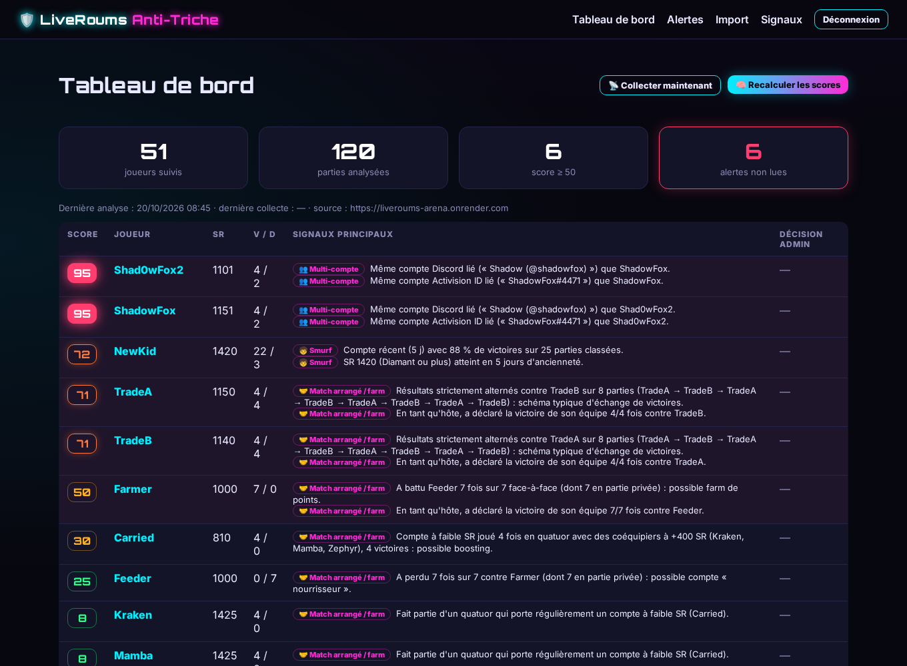

# 🛡️ LiveRoums Anti-Triche

Agent autonome d'aide à la décision pour **LiveRoums Arena** (Call of Duty). Il observe les **données publiques** du site, calcule pour chaque joueur un **score de suspicion de 0 à 100**, explique chaque point du score et **alerte l'administrateur**.

> ⚠️ L'agent **ne sanctionne jamais automatiquement**. Il ne modifie rien sur le site et n'a aucun accès privilégié : la décision (innocent / à surveiller / sanctionné côté site) est prise par un humain dans le tableau de bord. Elle est stockée uniquement dans la base de l'agent ; toute sanction s'applique manuellement sur le site.



## Ce qui est détecté

| Détecteur | Signaux (points) |
|---|---|
| **Smurf** | compte de ≤ 14 j avec ≥ 75 % de victoires sur ≥ 10 parties (30-40) · SR ≥ 1350 en ≤ 30 j (20) · taux de victoire statistiquement anormal, z ≥ 3 (15) · gain de SR ≥ 18/partie (25) · ≥ 150 SR/jour (10) |
| **Multi-comptes** | même compte lié (Activision ID, PSN, Xbox, Battle.net, Steam : 50 ; Discord : 55) · pseudos très proches **avec un 2ᵉ indice** (15) · comptes créés à < 24 h d'écart (10) · jouent presque toujours ensemble ou l'un contre l'autre (15) |
| **Matchs arrangés / win trading / farm** | résultats strictement alternés sur ≥ 6 duels (35) · ≥ 85 % de victoires sur ≥ 5 duels contre le même adversaire (25-45 ; 15-25 pour le « nourrisseur ») · l'hôte se déclare vainqueur ≥ 80 % du temps contre le même adversaire (20) · victoires très au-dessus de l'espérance Elo, z ≥ 2,5 (20) · boosting en quatuor (compte faible porté par 3 joueurs ≥ 400 SR au-dessus : 25-40) |

Les « duels » ne comptent que les petits formats (1v1 / 2v2) et les parties privées : en classé 4v4, c'est le matchmaking qui met les joueurs face à face, ce qui évite les faux positifs. Le score combine les signaux avec un rendement décroissant (×0,6 par signal supplémentaire d'un même détecteur) et est plafonné à 100. Une alerte est créée à partir de `ALERT_THRESHOLD` (50 par défaut), ou si le score d'un joueur déjà signalé augmente de 15 points. Un joueur marqué « innocent » n'est plus signalé tant que son score n'augmente pas.

## Sources de données

0. **Synchronisation automatique avec l'export admin du site (recommandé, source principale)** : si `SITE_EXPORT_TOKEN` est défini (même valeur que `ANTICHEAT_EXPORT_TOKEN` côté site), l'agent interroge `GET {SITE_URL}/api/admin/anticheat-export?since=…` avec `Authorization: Bearer` toutes les `EXPORT_INTERVAL_S` secondes (300 par défaut, minimum 60 ; la limite du site est de 6 req/min).
   - **Au démarrage, synchro complète** (la base Render est éphémère), puis **incrémentale** depuis la dernière synchro réussie (avec 2 min de chevauchement ; l'import est idempotent, donc aucun doublon).
   - Chaque synchro importe les données, recalcule les scores et crée les alertes (tableau de bord + webhook Discord). Les alertes sont dédupliquées : une nouvelle alerte n'est créée que si le score franchit le seuil pour la première fois ou augmente de 15 points ; les analyses sont sérialisées.
   - Erreurs gérées sans jamais arrêter le service : **401/403** (jeton refusé) et **404** (export désactivé sur le site) → nouvel essai dans 15 min, 30 min… ; **429** → respect de `Retry-After` ; réseau / réponse invalide → backoff exponentiel (2×, 4×… l'intervalle, plafonné à 1 h).
   - Le tableau de bord affiche l'état (dernière synchro réussie en heure de Paris, volumes, dernière erreur, prochaine tentative) et un bouton **« Synchroniser maintenant »** (protégé CSRF).
   - Tant que l'export fonctionne, la collecte des pages publiques est **en veille** (pas de double collecte) ; elle reprend automatiquement en secours si aucune synchro n'a réussi depuis 3 intervalles. Les deux sources fusionnent sur les mêmes clés (pseudo, code de partie), sans double comptage.

1. **Collecte automatique (HTTP)** depuis `SITE_URL`, en lecture seule, avec un seau à jetons qui respecte la limite du site (120 req/min/IP sur /api) : 40 req/min par défaut, plafonné à 100. Un cycle toutes les 180 s : classement → parties en cours connues → API joueurs (découverte des codes de partie) → 5 profils par cycle (rafraîchis chaque jour).
2. **Import manuel** (page *Import*) en JSON ou CSV, si un export est disponible.

### Format JSON
```json
{ "players": [{ "pseudo": "Bob", "platform": "PC", "member_since": "2026-10-01", "sr": 1200, "wins": 10, "losses": 4,
                "linked": [{ "provider": "Discord", "account_id": "Bob (@bob)", "verified": 1 }],
                "sr_history": [{ "sr": 1000, "at": "2026-10-01T10:00:00Z" }] }],
  "matches": [{ "code": "AB12CD", "kind": "classe", "winner_team": 1, "host": "Bob", "ended_at": "2026-10-02T21:00:00Z",
                "players": [{ "pseudo": "Bob", "team": 1, "sr_before": 1000, "sr_after": 1020 }] }] }
```
`kind` : `classe`, `rapide` ou `privee`.

### Format CSV (le type est déduit des en-têtes)
- joueurs : `pseudo,platform,member_since,sr,wins,losses`
- comptes liés : `pseudo,provider,account_id,verified`
- parties (une ligne par joueur) : `code,kind,winner_team,host,ended_at,pseudo,team,sr_before,sr_after`

## Signaux disponibles publiquement

| Source | Données | Utilisé pour |
|---|---|---|
| /classement (HTML) | Top 100 classé Call of Duty : pseudo, SR, victoires / défaites, % victoires. | Smurf (taux de victoire, SR), z-scores |
| /api/joueurs/:pseudo (JSON) | SR actuel, points LP, niveau, partie en cours (code), file classée / rapide. | Découverte des codes de parties en cours, suivi du SR dans le temps |
| /joueurs/:pseudo (HTML) | Plateforme, date d'inscription (jour), comptes liés (Discord, Activision ID, PSN, Xbox, Battle.net, Steam ; vérifié ou non), V/D, tournois. | Multi-comptes (mêmes comptes liés / Discord, comptes créés le même jour), âge du compte pour les smurfs |
| /api/parties/:code (JSON) | Statut, équipe gagnante, classé ou non, joueurs avec équipe, SR avant / après. | Win trading, farm, espérance Elo, boosting en quatuor, co-présence |
| /parties/:code (HTML) | Hôte (👑) et type exact (classée / rapide / privée). | Hôte qui se déclare vainqueur contre les mêmes adversaires, parties privées |
| /tournois/:id, /api/tournois | Brackets et vainqueurs des tournois. | (non exploité dans la v1) |

## Signaux indisponibles publiquement

| Signal | Pourquoi |
|---|---|
| Historique complet des parties | Les codes de partie ne sont visibles que pendant la partie (via /api/joueurs) : les parties courtes entre deux interrogations et tout l'historique antérieur au démarrage de l'agent sont invisibles. |
| Heures exactes | Création de compte (seulement le jour), début/fin de partie (l'agent ne connaît que l'heure d'observation). |
| Joueurs hors top 100 sans partie observée | Le classement public est limité à 100 joueurs ; les autres ne sont découverts que via les parties observées. |
| Composition des quatuors | Déduite seulement (mêmes coéquipiers en classé) ; le code et les membres du quatuor ne sont pas publics. |
| IP, empreinte d'appareil, email | Non collectés par le site (et non publics) : impossible de relier des comptes par l'adresse IP. |
| Historique des points LP (registre) | Seul le solde est public : farm de points visible uniquement via les parties observées. |
| Discord ID technique | Seul le nom affiché « Nom (@pseudo) » est public (suffisant pour une correspondance exacte, mais un renommage casse le lien). |
| Données in-game | Aucune (visée, temps de réaction…) : hors périmètre, aucune API Activision. |

### Endpoint d'export admin minimal proposé (non implémenté)

Un seul endpoint en lecture seule côté site débloquerait l'historique complet, les heures exactes, les quatuors et le registre de points :

```
GET /api/admin/anticheat-export?since=ISO8601   (lecture seule, en-tête Authorization: Bearer <EXPORT_TOKEN>, limité, paginé)
→ { users:   [{ pseudo, created_at, discord_id_hash, linked:[{provider, account_id_hash, verified}], last_login_ip_hash? }],
    lobbies: [{ code, kind, ranked, is_private, host, created_at, started_at, ended_at, winner_team,
                players:[{ pseudo, team, sr_before, sr_after, quatuor_id }] }],
    points:  [{ pseudo, amount, reason, created_at }] }   // identifiants sensibles hachés (HMAC) pour la confidentialité
```
L'agent sait déjà importer ce format via la page *Import* (adaptation minime du collecteur une fois l'endpoint en place).

## Installation locale

```bash
npm install
ADMIN_TOKEN="un-jeton-long-et-aleatoire" npm start            # http://localhost:3500
ADMIN_TOKEN="un-jeton-long-et-aleatoire" node scripts/demo.js  # démo avec données synthétiques, sans collecte (port 3501)
npm test                                                     # tests unitaires + e2e
```
Node.js 22 recommandé (≥ 20 fonctionne).

## Variables d'environnement

| Variable | Obligatoire | Défaut | Rôle |
|---|---|---|---|
| `ADMIN_TOKEN` | **oui** | — | Jeton de connexion au tableau de bord (≥ 16 caractères ; 32+ aléatoires conseillés) |
| `SESSION_SECRET` | **oui en production** | aléatoire | Secret des cookies de session (≥ 32 caractères ; généré par Render) |
| `NODE_ENV` | conseillé | — | `production` active les cookies `secure` et les contrôles stricts |
| `SITE_EXPORT_TOKEN` | conseillé | — | Jeton Bearer de l'export admin du site (= `ANTICHEAT_EXPORT_TOKEN` du site) ; active la synchro automatique |
| `EXPORT_INTERVAL_S` | non | 300 | Intervalle de synchro de l'export (min 60) |
| `ALLOWED_FRAME_ANCESTORS` | non | 'self' https://liveroums-arena.onrender.com | Origines autorisées à afficher le tableau de bord en iframe (CSP frame-ancestors) |
| `SITE_URL` | non | https://liveroums-arena.onrender.com | Site surveillé |
| `COLLECT_ENABLED` | non | 1 | `0` pour désactiver la collecte (import seul) |
| `COLLECT_RPM` | non | 40 | Requêtes/min vers le site (max 100) |
| `COLLECT_INTERVAL_S` | non | 180 | Intervalle entre deux cycles (min 60) |
| `ALERT_THRESHOLD` | non | 50 | Score déclenchant une alerte |
| `DISCORD_WEBHOOK_URL` | non | — | Envoi des alertes dans un salon Discord |
| `SMTP_URL`, `ALERT_EMAIL_TO`, `ALERT_EMAIL_FROM` | non | désactivé | Alertes par email (désactivées par défaut) |
| `LLM_API_KEY`, `LLM_API_URL`, `LLM_MODEL` | non | désactivé | Résumé IA des alertes (API compatible OpenAI, défaut gpt-4o-mini) |
| `DB_FILE` / `DATA_DIR` | non | ./data/anticheat.db | Emplacement de la base SQLite |
| `PORT` | non | 3500 | Port HTTP (fourni par Render) |

## Déploiement Render (gratuit)

1. Pousser ce dépôt sur GitHub (`Memecoinsphere/liveroums-anticheat`).
2. Render → *New* → *Blueprint* → choisir le dépôt (`render.yaml` est détecté) → saisir `ADMIN_TOKEN` (et le webhook Discord si voulu).
3. Limites du plan gratuit :
   - **Base éphémère** : le disque est effacé à chaque redéploiement ou redémarrage. Les scores sont recalculés à partir des nouvelles observations, mais **les décisions admin et l'historique sont perdus**. Pour les conserver, passer sur un plan avec disque persistant (`DATA_DIR` sur le disque) ou réimporter un export.
   - **Garder l'agent éveillé (important pour l'automatisme)** : les minuteries internes de l'agent (synchro, collecte) **ne suffisent pas** à empêcher la mise en veille, car Render ne compte que le trafic HTTP entrant ; un « auto-ping » depuis le service lui-même ne marche pas non plus de façon fiable. Il faut un pinger **externe** sur `/healthz` (≤ 10 min). À chaque réveil, une synchro complète est relancée automatiquement.
   - **Mise en veille** après 15 min sans trafic, ce qui stoppe la collecte. Configurer un pinger externe (UptimeRobot, cron-job.org…) sur `https://<service>.onrender.com/healthz` toutes les 10 min.

## Sécurité

Intégration au site : le tableau de bord s'affiche dans la page admin `/admin/anti-triche` du site via une iframe. Seules les origines de `ALLOWED_FRAME_ANCESTORS` peuvent l'intégrer (CSP `frame-ancestors`, X-Frame-Options retiré car il ne sait pas autoriser une autre origine). En production, le cookie de session est `SameSite=None; Secure` pour que la connexion fonctionne dans l'iframe ; la protection CSRF par jeton reste exigée sur tous les POST. Si le site change d'adresse, mettre à jour cette variable.

Helmet avec CSP à nonce, session `httpOnly` / `SameSite=Strict` (local) / `SameSite=None` (production, pour l'iframe) / `secure` (8 h), protection CSRF sur tous les POST, comparaison du jeton à temps constant, limites de débit (300 req/min global, 10 connexions/15 min), webhook Discord sans mentions. Aucune donnée sensible n'est collectée : uniquement ce qui est déjà public sur le site.
